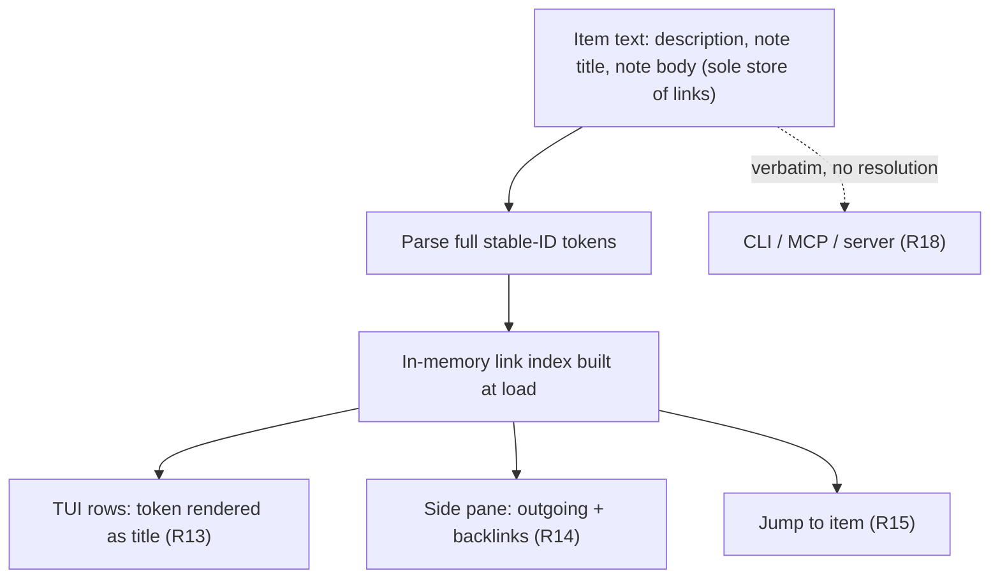
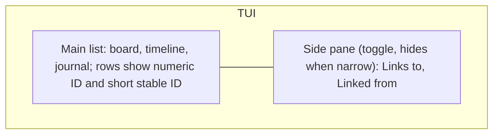
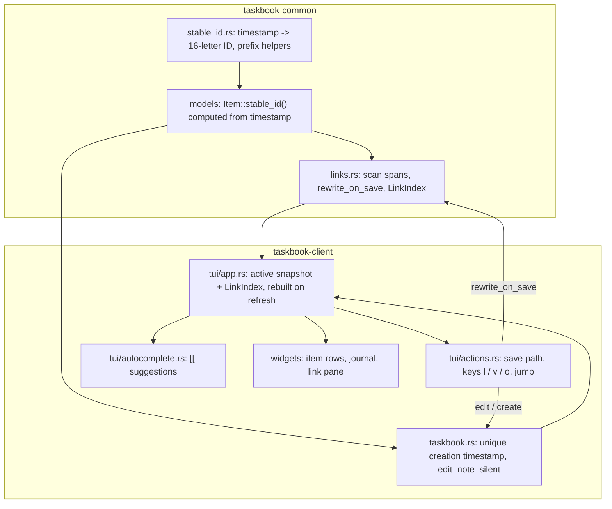
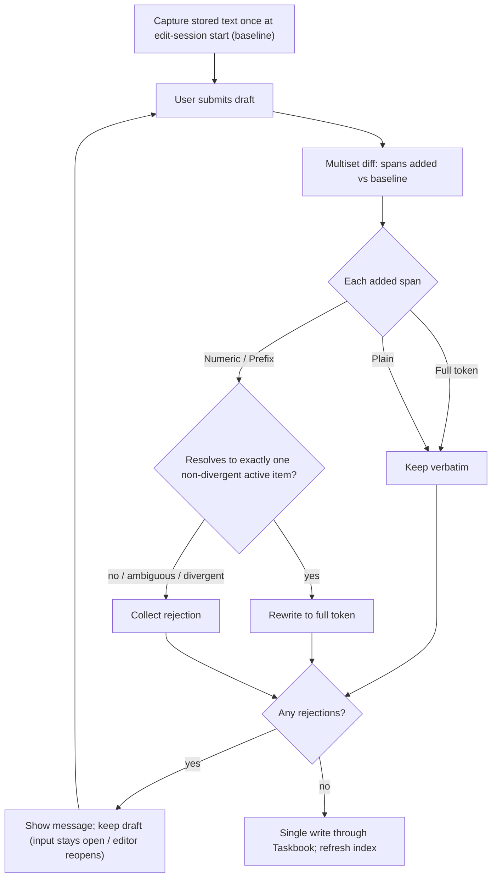

# Backlinks - Plan

## Goal Capsule

- **Objective:** In the TUI, a user can link any task or note to another with an inline `[[…]]` reference, see from any item what it links to and what links to it, and jump between them, with links that survive edits, moves, archive, restore, and sync; a link to an archived item shows as broken until that item is restored.
- **Means:** a jj-style stable ID computed from each item's creation timestamp, and `[[stable-id]]` tokens in item text resolved by a client-side link index (KTD1, KTD5).
- **Authority:** the Product Contract wins on behavior; Key Technical Decisions win on mechanism within their cited requirements; units override neither.
- **Product Contract preservation:** changed: R3 (ID derived from `_timestamp` alone, computed on read, never stored), R8 (which `[[…]]` spans count as references), R10 (newly added full tokens are kept too), Key Decision "Deterministic, creation-time IDs" reworded; added R19, R20, AE7; Dependencies bullets about older binaries dropping a stored field and a first-load full write removed; planning questions resolved into KTDs. All confirmed by the user in plan scoping.
- **Stop conditions:** stop and ask if implementing R3 would require storing a new field, if the derivation function would need to change after any link has been written, or if a unit cannot meet R9 without changing behavior outside the TUI.
- **Execution profile:** Rust workspace; client and common crates only; the server is untouched.
- **Open blockers:** none.

---

## Product Contract

### Summary

Items gain a permanent, letters-only stable ID alongside the existing numeric ID, modeled on jj's change ID vs commit ID split and computed from the item's creation time. Links are `[[stable-id]]` tokens in item text, which is the only place they are stored. The TUI resolves them into titles, shows outgoing links and backlinks in a side pane, and lets the user jump between linked items.

### Problem Frame

Taskbook has no durable way to say "this note is the context for that task" or "this task depends on that one." The only handle on an item is its numeric ID, and that ID is positional: it is `max + 1` at creation, it is reassigned when an item is archived, reassigned again when it is restored, and reused when the highest-numbered item is deleted. A reference written as "see #12" today can silently point at a different item tomorrow.

This is the same problem jj solves by separating the change ID (permanent, what users see and type) from the commit ID (content-derived, rewritten constantly, secondary). Taskbook's numeric ID plays the commit-ID role and has no change-ID counterpart.

Because sync stores items as opaque client-encrypted blobs and replaces the whole set on each `PUT /items`, any linking scheme has to work entirely on the client and tolerate last-write-wins across devices.

### Key Decisions

- **Inline links, text as the single source of truth, plus a non-text way to add one.** Links live in the item text; a TUI keybind appends a token rather than maintaining a separate relation list. Governs R7, R11. (session-settled: user-directed — chosen over explicit-only structured relations and over inline-only: inline matches the Workflowy model, the keybind covers linking without editing text.)
- **Tokens carry only the stable ID.** Raw text shows `[[kqzxmvtn…]]`; views render the title. Governs R7, R13. (session-settled: user-directed — chosen over `[[Title|id]]` and `[[Title]]`: no stale titles in text, no rename or duplicate-title breakage.)
- **A new stable ID beside the numeric ID, shown jj-style in the TUI.** Numeric IDs keep working unchanged; the stable ID is displayed as a shortest unique prefix. Governs R1, R4, R6. (session-settled: user-directed — chosen over making numeric IDs permanent, over a hidden-only stable ID, and over replacing numeric IDs everywhere: it follows jj's model without breaking CLI muscle memory or pulling the CLI into scope.)
- **Letters-only alphabet, full ID in tokens, shortest prefix displayed.** Lexical disjointness makes `[[12]]` and `[[kqz]]` unambiguous without lookup; prefixes never go into stored text because a unique prefix can become ambiguous as items are added. Governs R2, R6, R7, R8. (session-settled: user-approved — proposed from jj's reverse-hex change IDs with the prefix-ambiguity tradeoff shown.)
- **Deterministic, creation-time IDs.** Every client derives the same ID for the same item, so sync and mixed devices agree without coordination. Governs R3. (session-settled: user-approved — chosen over random backfill: random IDs plus last-write-wins `PUT /items` would silently break links made on the losing client.)
- **Creation time alone is the identity, HUID-style.** The ID depends only on `_timestamp`, is never stored, and uniqueness is enforced when an item is created; items that already share a timestamp are accepted as divergent. Governs R3, R5, R19, R20. (session-settled: user-directed — chosen over deriving from `_timestamp` plus `_isTask` into a stored field: no data-format change and nothing for older binaries to drop, at a scale where same-millisecond creation is negligible; precedent: the HUID scheme in alycda/dotfiles `tasks/README.md`.)
- **TUI only for v1.** Governs R18. (session-settled: user-directed — chosen over also covering CLI and MCP.)
- **Outside the TUI, tokens stay raw.** Governs R18. (session-settled: user-directed — chosen over read-only title rendering in CLI/MCP: zero work outside the TUI and lossless MCP round-tripping.)
- **Archived targets are broken links.** Governs R16. (session-settled: user-directed — chosen over resolving archived targets with an "archived" marker and over full archive parity; the jj hidden-commit analogy was raised afterward and the choice was kept.)
- **Side pane for links and backlinks.** Governs R14, R15, R17. (session-settled: user-directed — chosen over a filter-view swap and a popup: links stay visible while browsing.)

### Requirements

**Stable identity**

- R1. Every task and note has a stable ID that is assigned once and never changes across edit, move, star, state change, archive, restore, or sync.
- R2. Stable IDs use a letters-only alphabet, so no stable ID or prefix of one can be read as a numeric ID.
- R3. Every stable ID is a deterministic function of the item's creation timestamp alone, computed whenever the item is read and never stored, so every client and every version that keeps `_timestamp` agrees on it.
- R19. Creating an item gives it a creation timestamp that no other active or archived item has, so new items never share a stable ID.
- R20. Items that already share a creation timestamp are divergent: the TUI marks them, they are not jump targets, and a save that adds a reference to one is rejected per R9.
- R4. Numeric IDs keep their current allocation and behavior for every existing CLI, TUI, and MCP operation.
- R5. Older taskbook-rs versions can still read item data written by this version.
- R6. The TUI shows each item's stable ID as its shortest unique prefix, visually distinguished, next to the numeric ID.

**Writing links**

- R7. A link is a `[[<full stable ID>]]` token in a task description, note title, or note body; only well-formed full stable-ID tokens are links, and any other `[[…]]` in stored text is plain text.
- R8. When text is saved from TUI input or from the TUI-launched `$EDITOR`, each `[[N]]` (digits only) and `[[<prefix>]]` (stable-ID alphabet letters only) added in this edit is rewritten to the full stable-ID token of the matching active item; such spans already present in the text before the edit, and any `[[…]]` containing other characters, stay verbatim as plain text.
- R9. A save that adds a numeric or prefix reference matching no active item, or more than one, is rejected with a message naming the reference, nothing is written, and the user's draft is kept: TUI input stays open with its text, and `$EDITOR` reopens on the edited content.
- R10. Full stable-ID tokens, whether already in the text or newly added, are preserved verbatim on save, whatever the state of their target.
- R11. A TUI keybind on the selected item lets the user pick a target item and appends a link token to the selected item's description without manual text editing.
- R12. Typing `[[` in TUI text input opens item autocomplete, and accepting a suggestion inserts the full stable-ID token.

**Viewing and following links**

- R13. TUI item rows render each link token as the target's current title, visually marked as a link, instead of the raw ID.
- R14. A side pane shows the selected item's outgoing links and its backlinks (active items whose text links to it), each as title plus short stable ID, and updates as the selection moves.
- R15. From the side pane the user can jump to any listed item that is active and not divergent, and the TUI switches board or view as needed so that item is selected and visible.
- R16. A link whose target is archived or absent renders as a broken-link marker, archived items contribute no backlinks, and restoring an item makes its backlinks and outgoing links resolve again with no other action.
- R17. The side pane can be toggled with a key and is hidden automatically when the terminal is narrower than a minimum width.

**Outside the TUI**

- R18. CLI output and input, MCP tools, and the server are unchanged, and link tokens appear there verbatim.

### Key Flows

- F1. Link while writing
  - **Trigger:** User creates or edits a task in the TUI.
  - **Steps:** Types `[[`; autocomplete lists items; user picks a note; the full token is inserted; user saves.
  - **Outcome:** The task row shows the note's title as a link; selecting the note shows the task under its backlinks.
  - **Covered by:** R7, R12, R13, R14
- F2. Link without editing text
  - **Trigger:** User presses the link keybind on a selected item.
  - **Steps:** Picks a target; token is appended to the selected item's description.
  - **Outcome:** Same as F1.
  - **Covered by:** R11, R14
- F3. Follow a backlink
  - **Trigger:** User selects an item with backlinks.
  - **Steps:** Side pane lists backlinks; user moves to an entry and confirms.
  - **Outcome:** The backlinking item is selected and visible, on its own board or view.
  - **Covered by:** R14, R15
- F4. Archive and restore a linked item
  - **Trigger:** User deletes an item other items link to, then later restores it.
  - **Steps:** Delete moves it to the archive; items linking to it show broken markers. Restore brings it back with a new numeric ID and the same stable ID.
  - **Outcome:** Links resolve again and the backlinks reappear.
  - **Covered by:** R1, R16

### Acceptance Examples

- AE1. **Covers R8, R9.**
  - **Given** active item 12 exists, no item 99 exists, and two active items have stable IDs starting `kq`.
  - **When** the user saves `see [[12]]`, `see [[99]]`, and `see [[kq]]` in turn.
  - **Then** the first is stored as the full token for item 12; the second and third are rejected with a message naming `[[99]]` and `[[kq]]`, and nothing is written.
- AE2. **Covers R10, R16.**
  - **Given** a note body containing a full-ID link to an archived task.
  - **When** the user edits an unrelated line of the note in `$EDITOR` and saves.
  - **Then** the save succeeds, the token is unchanged, and the link still renders as broken.
- AE3. **Covers R7, R8, R9, R18.**
  - **Given** a task created via the CLI as `tb --task "see [[12]]"`.
  - **When** it is viewed in the TUI, and later edited there (for example, a typo fix elsewhere in the text) and saved.
  - **Then** `[[12]]` stays plain text, not a link, both times; the edit saves normally and no backlink appears on item 12.
- AE4. **Covers R3.**
  - **Given** two synced clients holding the same pre-upgrade items.
  - **When** both upgrade and load before either syncs.
  - **Then** each item has the same stable ID on both clients, and links made on either client resolve on both after sync.
- AE5. **Covers R1, R16.**
  - **Given** task 7 is linked from three items.
  - **When** task 7 is deleted, then restored and assigned numeric ID 15.
  - **Then** while archived, all three linking items show a broken marker and task 7 appears in no backlink list; after restore, all three links resolve to task 15 and its side pane lists the three backlinks.
- AE6. **Covers R17.**
  - **Given** a terminal narrower than the minimum width.
  - **When** the TUI starts or is resized below it.
  - **Then** the side pane is hidden and the main list uses the full width; widening the terminal restores the pane if it was toggled on.
- AE7. **Covers R19, R20.**
  - **Given** an MCP agent creates three tasks within the same millisecond, and the store already holds two legacy notes that share one `_timestamp`.
  - **When** the TUI loads.
  - **Then** the three new tasks have three distinct stable IDs; the two legacy notes show a divergent marker, are not offered by `[[` autocomplete, and saving `[[<their prefix>]]` is rejected.

### Scope Boundaries

**Deferred for later**

- CLI rendering of link tokens, `tb --link`, `tb --backlinks`, and accepting stable IDs as CLI targets (the CLI `@` sigil already means boards).
- MCP link fields on `list_items`, a link tool, and protecting tokens from being dropped by `edit_item`.
- A warning when deleting an item that has backlinks.
- Resolving archived targets with an "archived" marker instead of a broken one.

**Outside this work's identity**

- Workflowy-style mirrors or transclusion (one item shown live in two places).
- Links to boards or tags, and hierarchical parent/child items.
- Any server-side link index; the server never sees plaintext.

### Dependencies / Assumptions

- Nothing in taskbook-rs changes `_timestamp` after creation (only `Task::new`, `Note::new`, `Note::new_with_body` set it), and older taskbook-rs versions keep it on every write, so their writes cannot change a stable ID.
- The original Node.js taskbook is assumed to keep `_timestamp` unchanged when it rewrites `storage.json`; it has not been checked. If it rewrote timestamps, links to affected items would break.
- Items created by older binaries, Node taskbook, or two devices in the same millisecond can share a timestamp; R20 governs how they appear.
- MCP `edit_item` replaces the whole description (`crates/taskbook-client/src/mcp/tools.rs:387`), so an agent that rewrites a title without copying a token removes that link, and nothing catches it.
- Sync stays last-write-wins on the whole item set (`crates/taskbook-server/src/handlers/items.rs:144`); this plan does not change it.

### Sources / Research

- ID allocation and renumbering: `crates/taskbook-client/src/taskbook.rs:71` (`generate_id`, `max + 1`), `:323` (`save_item_to_archive`), `:337` (`save_item_to_storage`).
- Item models and serde compatibility: `crates/taskbook-common/src/models/task.rs`, `crates/taskbook-common/src/models/note.rs`.
- Existing sigils: `+tag` and `@board` parsing in `crates/taskbook-common/src/board.rs:90`; `@<id>` targets in `crates/taskbook-client/src/taskbook.rs:730`; `[[` is unused in the client.
- Sync storage: opaque per-item blobs keyed by `item_key` in `crates/taskbook-server/src/migrations/001_initial.sql`; full-set replace in `crates/taskbook-server/src/handlers/items.rs`.
- TUI layout: a single vertical split in `crates/taskbook-client/src/tui/ui.rs:20`; `PopupState` has only `Help` (`crates/taskbook-client/src/tui/app.rs:106`); no width-based layout today.
- TUI autocomplete: `@` suggests boards, item suggestions come from bare tokens after `/` commands (`crates/taskbook-client/src/tui/autocomplete.rs:42`, `:67`, `:160`).
- Note bodies: edited in `$EDITOR` (`crates/taskbook-client/src/editor.rs`); the TUI shows only a `[...]` marker or the journal's first line (`crates/taskbook-client/src/tui/widgets/item_row.rs:80`, `crates/taskbook-client/src/tui/widgets/journal_view.rs:150`).
- jj change ID vs commit ID, reverse-hex alphabet, shortest-prefix display, divergent changes: https://jj-vcs.github.io/jj/latest/glossary/#change-id
- HUID (creation time as identity, collision handled at creation): alycda/dotfiles, branch `effver`, `tasks/README.md` and `CONCEPTS.md`.

---

## Planning Contract

### Key Technical Decisions

- KTD1. **Stable ID = invertible 64-bit mix of `_timestamp`, written as 16 letters `k`–`z`.** The timestamp's bits (as `u64`, two's complement, so 0 and negative values are covered) go through a fixed invertible mixer (an xorshift-multiply finalizer with odd multipliers, in the style of splitmix64's finalizer), and each 4-bit nibble maps to one letter of `klmnopqrstuvwxyz` (jj's reverse-hex alphabet). Invertibility means distinct timestamps never collide; mixing means items created minutes apart get unrelated prefixes, keeping displayed prefixes short. Hand-written, no new dependency; never `std`'s `DefaultHasher`, whose output is not stable across Rust releases. Lives in a new pure module `crates/taskbook-common/src/stable_id.rs`, frozen by golden test vectors. Implements R2, R3. (session-settled: user-directed — chosen over hashing `_timestamp` plus `_isTask` into a stored field: no data-format change, HUID precedent.)
- KTD2. **Computed on read, never serialized.** `stable_id()` is an accessor on the `Item` trait and the mirrored inherent methods of `StorageItem` that computes from `timestamp`; no serde field is added, so `storage.json`, the sync payload, and older binaries are unaffected (R3, R5). The link index caches computed IDs per refresh.
- KTD3. **Uniqueness at creation by bumping `_timestamp`.** Every `Taskbook` create path takes the candidate timestamp and, if any active or archived item already has it, increments by 1 ms until free; this covers CLI, TUI, MCP, and editor-created notes because they all go through `Taskbook` (R19). The archive is read on create to make the check complete; in remote mode that is one extra `GET` per create, acceptable at taskbook's scale. A bump of a few milliseconds has no visible effect: `timestamp` only drives ordering and age display.
- KTD4. **Divergence is detected, not repaired.** The link index groups active items by stable ID; any ID held by more than one active item is divergent (R20). An archived copy sharing an ID with an active item (a half-finished delete) is ignored, because archived items contribute nothing to the index. Automatic repair is deferred.
- KTD5. **Link logic is a pure module, `crates/taskbook-common/src/links.rs`.** It owns three things: the span scanner, the save-time rewrite, and the link index. It takes plain item data, has no TUI or storage dependency, and carries the bulk of the tests. Follows the shape of `crates/taskbook-common/src/due.rs`.
- KTD6. **Span classification.** The scanner finds closed `[[…]]` spans; the inner text classifies as Full (exactly 16 alphabet letters), Numeric (digits only), Prefix (1–15 alphabet letters), or Plain (anything else, including mixed or other letters). Matching is case-insensitive and rewritten tokens are lowercase. An unclosed `[[` is not a span.
- KTD7. **"Added in this edit" is a multiset diff against the stored baseline.** The baseline is the item's stored text captured once when the edit session starts (when `e` or `l` prefills the command line, when a typed `/edit` is first submitted, or when the editor opens; empty for a create) and reused unchanged for every retry, so a rejected `[[99]]` cannot become "pre-existing" on the second try. For notes, title and body are diffed together so moving a span between them is not an addition. For each span text, the first k occurrences (k = baseline count) stay verbatim and later occurrences are added (R8, R10).
- KTD8. **Rewrite outcome is a value, not an error.** `rewrite_on_save(baseline, draft, index)` returns either the rewritten text or a list of rejected references with reasons (not found, ambiguous prefix, divergent target). Full tokens are never rejected (R10). Callers in the TUI show the message as a status and keep the draft.
- KTD9. **TUI keeps an active-items snapshot and a `LinkIndex` independent of the view.** `App` loads active items in every view (Archive view currently replaces `app.items`), rebuilding the index in `refresh_items`, `set_view`, the SSE handler for both active and archive changes, and after restore. Prefix uniqueness is computed over active items; an archived row's prefix is computed over active items plus itself.
- KTD10. **A rejected submit re-opens the command line with the draft.** Submit keeps today's order (push history, deactivate, execute), because `deactivate_command_line` resets `pending_confirm` and moving it after execution would cancel the `/delete` and `/clear` confirmations. When the link rewrite rejects, the action re-activates the command line with the submitted input and cursor and sets the error status (R9). Other storage errors keep today's behavior.
- KTD11. **Note editor saves validate first, then write once.** A new `Taskbook::edit_note_silent(id, title, body)` replaces the title-then-body pair of writes in `edit_note_external`, so a rejection can never leave a half-saved note. On rejection the editor reopens on the edited title and body, with the rejection message as a leading `//` comment line (already stripped by `parse_note_content`). The `/note` create-then-editor flow uses the same validation with an empty baseline.
- KTD12. **The link keybind reuses the command line.** `l` on a selected active item opens the command line as `/edit @<id> <current description> [[` with item suggestions already showing; accepting one and pressing Enter saves through the normal rewrite path (R11). For notes the token goes on the title (the `/edit` target). No new picker widget.
- KTD13. **`[[` autocomplete.** `update_suggestions` gains a branch, checked before the `@` branch, for an unclosed `[[` before the cursor in the description position of `/task`, `/note`, and `/edit`. Candidates: active, non-divergent items, excluding the item being edited, shown as rendered title, short stable ID, and board, matched by substring on rendered title, numeric ID, or stable-ID prefix. Accepting inserts `[[<full id>]]`. While a `[[` dropdown is open, Enter accepts instead of submitting.
- KTD14. **Keys:** `l` link, `v` toggle the side pane, `o` move focus into the pane (`j`/`k` move, Enter jumps, `o` or Esc returns to the list). Tab and `h` are already bound. Pane visibility is session-local in v1 and starts visible.
- KTD15. **Jump does not touch saved settings.** Jumping clears the search term and board filter, switches Archive view to Board view through a non-persisting path, and reveals a completed target with a transient override instead of flipping the persisted hide-completed setting; a status line names what changed. Broken and divergent entries are listed but not jumpable (R15, R16, R20).
- KTD16. **Rendering substitutes one level.** A token renders as the target's current title; tokens inside that title render as short stable IDs, so cycles cannot recurse. Broken tokens render as the short ID with a broken marker; divergent ones with a `??` suffix, as jj does. The same render function feeds rows, the pane, suggestions, and the journal preview (which also moves from byte to character truncation).
- KTD17. **Pane content rules.** Each target appears once per list however many times it is linked; a self-link is allowed and listed under outgoing links but never as a backlink of itself. Broken outgoing links are listed. When an archived item is selected in Archive view, its backlinks list shows the active items still linking to it.
- KTD18. **Pane layout.** When visible and the terminal is at least 100 columns wide, the content area splits horizontally with the pane on the right (about 30% width, minimum 32 columns); below 100 columns it is hidden and the toggle state is kept (R17). The autocomplete overlay is drawn after the pane so it is never covered.

### High-Level Technical Design

Components and data flow. Items load through `Taskbook`; the TUI builds one `LinkIndex` from the active set; every surface reads from it.

Save path for any TUI text save (command line or `$EDITOR`):

Stable-ID derivation (directional, not a specification): `id = encode_k_to_z(mix(timestamp as u64))`, where `mix` is a bijection on `u64` and `encode` emits 16 nibbles most-significant first. The exact constants are fixed once in U1 and never changed afterwards.

### Alternatives Considered

- **Stored field plus deterministic backfill** from `_timestamp` and `_isTask`. Rejected: older binaries drop unknown fields on write, so the stored value buys nothing that recomputation does not, and it adds a data-format change and a first-load full write that races last-write-wins sync.
- **Truncated hash instead of a bijection.** Rejected: introduces birthday collisions between distinct timestamps for no benefit.
- **Direct base-16 encoding of the timestamp without mixing.** Rejected: items created the same day share long prefixes, defeating short display IDs.
- **A dedicated picker popup for the link keybind.** Rejected for v1: the command line with `[[` autocomplete already provides search, selection, and cancel.

### Assumptions

- At taskbook's scale (hundreds to low thousands of items), rebuilding the link index on every refresh is cheap enough without incremental updates.
- Users do not routinely write literal `[[…]]` text made only of `k`–`z` letters; when they do and it matches nothing, R9 rejects the save with a message naming it.

---

## Implementation Units

### U1. Stable ID derivation

**Goal:** a frozen, pure function from creation timestamp to stable ID, plus prefix helpers, exposed on every item.

**Requirements:** R1, R2, R3, R5; AE4. Implements KTD1, KTD2.

**Dependencies:** none.

**Files:**
- `crates/taskbook-common/src/stable_id.rs` (new)
- `crates/taskbook-common/src/lib.rs`
- `crates/taskbook-common/src/models/item.rs`
- `crates/taskbook-common/src/models/mod.rs`
- Tests: inline `#[cfg(test)] mod tests` in `stable_id.rs`, `models/task.rs`, `models/note.rs`

**Approach:**
1. Implement the mixer, its inverse (test-only is fine), and the `k`–`z` encoder and decoder.
2. Add helpers: `is_valid_full_id`, `is_valid_prefix`, and `shortest_unique_prefix_lengths` over a set of IDs.
3. Add `stable_id()` to the `Item` trait and the mirrored `StorageItem` inherent methods; no serde change.

**Patterns to follow:** `crates/taskbook-common/src/due.rs` (pure module, exhaustive unit tests); the accessor pairs in `crates/taskbook-common/src/models/mod.rs`.

**Test scenarios:**
- Golden vectors: at least five fixed timestamps (including 0, -1, `i64::MIN`, `i64::MAX`, and a 2026 timestamp) map to fixed 16-letter IDs; these values are written once and must never change.
- Round trip: decoding then inverting the mix returns the original timestamp for a spread of values.
- Every output is exactly 16 characters from `klmnopqrstuvwxyz`.
- Two timestamps 1 ms apart produce IDs whose first letters differ for most sampled pairs (prefix dispersion).
- `stable_id()` is identical for a task and a note with the same timestamp, and unchanged after changing description, boards, tags, star, completion, and numeric ID.
- Covers AE4. Serializing an item and deserializing it on another `StorageItem` yields the same stable ID, and serialized JSON contains no new field.
- Shortest-unique-prefix: with IDs sharing a two-letter prefix the result is length 3; a lone ID gets length 1.

**Verification:** stable IDs appear through the accessor; `storage.json` written by this version is byte-identical in shape to before (no new keys).

### U2. Unique creation timestamps

**Goal:** no two items created through taskbook-rs share a timestamp.

**Requirements:** R19, R1; AE7 (creation half). Implements KTD3.

**Dependencies:** U1.

**Files:**
- `crates/taskbook-client/src/taskbook.rs`
- Tests: new `#[cfg(test)] mod tests` in `crates/taskbook-client/src/taskbook.rs`

**Approach:**
1. Add one private helper that, given the candidate timestamp, reads active and archive data and returns the smallest unused timestamp at or after it.
2. Apply it in every create path: `create_task`, `create_task_direct_with_tags`, `create_note`, `create_note_direct_with_tags`, `create_note_with_body_direct`, `create_note_with_editor` (the constructors keep calling `Local::now()`; the helper overwrites `timestamp` before insert).

**Patterns to follow:** the `Taskbook::with_storage(Box::new(LocalStorage::new(temp_dir().join(..))))` fixture in `crates/taskbook-client/src/mcp/mod.rs` tests.

**Test scenarios:**
- Covers AE7. Creating 20 tasks and notes back to back yields 20 distinct timestamps and 20 distinct stable IDs.
- An archived item holding timestamp T forces a new item created at T to T+1.
- Active items at T and T+1 force a new item created at T to T+2.
- Archive and restore leave the timestamp and stable ID unchanged while the numeric ID changes.

**Verification:** every create path goes through the helper; existing CLI and MCP tests still pass unchanged (R4).

### U3. Span scanner and save-time rewrite

**Goal:** a pure function that turns a draft into the text to save, or a list of rejected references.

**Requirements:** R7, R8, R9, R10, R20; AE1, AE2, AE3. Implements KTD6, KTD7, KTD8.

**Dependencies:** U1.

**Files:**
- `crates/taskbook-common/src/links.rs` (new)
- `crates/taskbook-common/src/lib.rs`
- Tests: inline in `links.rs`

**Approach:**
1. Scanner returns closed spans with byte ranges and classification.
2. `rewrite_on_save` takes the baseline text, the draft text, and a resolver view of the active set (numeric ID to stable ID, prefix lookup, divergent set) and applies the multiset rule.
3. Note callers pass title and body joined with a separator that cannot occur inside a span, and split the result back.

**Test scenarios:**
- Covers AE1. `see [[12]]` with item 12 active rewrites to its full token; `[[99]]` is rejected as not found; `[[kq]]` with two matches is rejected as ambiguous.
- Covers AE3. Baseline `see [[12]]`, draft `see [[12]] typo-fixed` returns the draft unchanged.
- Covers AE2. A pre-existing full token to a missing target is kept and the save succeeds.
- A newly added full token to a missing target is kept (R10).
- Baseline with one `[[12]]`, draft with two: the first stays plain, the second is rewritten.
- A span moved from note body to title is not treated as added.
- `[[todo]]`, `[[bin]]`, `[[12a]]`, and `[[ ]]` are plain text and never rejected.
- Uppercase `[[KQZ]]` resolves case-insensitively and is written lowercase.
- A reference resolving to a divergent ID is rejected with a divergent reason (R20).
- An unclosed `[[12` is left as text.
- Retry: after a rejection, calling again with the same baseline and a draft that still contains `[[99]]` rejects again.

**Verification:** the function is total (never panics) on arbitrary UTF-8 input, including multibyte text adjacent to brackets.

### U4. Link index and rendering

**Goal:** one structure that answers every display question: outgoing links, backlinks, prefix lengths, divergence, and rendered text.

**Requirements:** R6, R13, R14, R16, R20. Implements KTD4, KTD16, KTD17.

**Dependencies:** U1, U3.

**Files:**
- `crates/taskbook-common/src/links.rs`
- Tests: inline in `links.rs`

**Approach:**
1. `LinkIndex::build(active items)` computes ID→items, divergent set, prefix lengths, and per-item outgoing targets from description, title, and body.
2. Backlinks are the reverse map, deduplicated, excluding self.
3. A render function turns text into segments (plain, link with resolved title, broken, divergent) with one level of substitution; callers style the segments.

**Test scenarios:**
- Item A links B twice and itself once: A's outgoing lists B and A once each; B's backlinks list A; A's backlinks do not list A.
- A links to an ID not in the active set: outgoing shows it as broken, and no backlink is created anywhere.
- Covers AE5 (index half). Building with B removed (archived) makes A's link broken; rebuilding with B present again restores the backlink.
- Two active items share an ID: the ID is in the divergent set and renders with the divergent marker.
- A titled "see [[B]]" and B titled "re [[A]]": rendering A shows B's title with A as a short ID, without recursion.
- Prefix lengths are the shortest unique over active items; an archived item's prefix computed against active plus itself.

**Verification:** index build over 5,000 synthetic items completes without noticeable delay in a debug test run.

### U5. TUI link state and refresh

**Goal:** the TUI always holds a current index of active items, in every view, including right after restore.

**Requirements:** R14, R16; AE5. Implements KTD9.

**Dependencies:** U4.

**Files:**
- `crates/taskbook-client/src/tui/app.rs`
- `crates/taskbook-client/src/tui/mod.rs`
- `crates/taskbook-client/src/tui/actions.rs`
- Tests: new `#[cfg(test)] mod tests` in `crates/taskbook-client/src/tui/app.rs`

**Approach:**
1. Add an `App::with_taskbook(Taskbook, Config, config_path)` test constructor, and route every `self.config.save()` in `App` (`set_view`, `toggle_hide_completed`, `cycle_sort_method`) through a helper that writes to that path, so tests never touch `~/.config/taskbook/taskbook.json`.
2. Add the active snapshot and `LinkIndex` to `App`; rebuild in `refresh_items`, `set_view`, after restore, and in the SSE handler for both data and archive changes.
3. Make restore reload the archive list and the index explicitly; `r` on a row that no longer exists sets a status instead of returning an error.

**Patterns to follow:** existing `refresh_items` and SSE `DataChanged` handling.

**Test scenarios:**
- Covers AE5. Create A, B, C linking to T; delete T: index shows three broken links and T has no backlinks; restore T from the archive view: index shows three backlinks on T without any other action.
- In Archive view, the index still reflects active items, not archived ones.
- Pressing restore twice on the same archived row leaves the TUI running and shows a status.

**Verification:** switching views never empties the side pane's source data.

### U6. TUI save path with rewrite and reject

**Goal:** every TUI text save goes through the rewrite, and rejection keeps the draft.

**Requirements:** R8, R9, R10; AE1, AE2, AE3. Implements KTD10, KTD11.

**Dependencies:** U3, U5.

**Files:**
- `crates/taskbook-client/src/tui/actions.rs`
- `crates/taskbook-client/src/editor.rs`
- `crates/taskbook-client/src/taskbook.rs`
- Tests: `crates/taskbook-client/src/tui/app.rs` tests module; `crates/taskbook-client/src/editor.rs` tests; `crates/taskbook-client/src/taskbook.rs` tests

**Approach:**
1. Route `/task`, `/note`, and `/edit` descriptions through `rewrite_on_save` before calling `Taskbook`; baseline is empty for creates and, for `/edit`, the stored description captured at session start per KTD7 and kept on `App` across retries.
2. On rejection, re-activate the command line with the submitted input and cursor and set the error status (KTD10); leave the submit order unchanged.
3. Add `Taskbook::edit_note_silent(id, title, body)` as a single write and use it in `edit_note_external`.
4. Capture the stored title and body once when the editor session starts; on rejection reopen the editor on the edited content with a leading `//` message line, looping until the save succeeds or the user cancels.

**Patterns to follow:** status handling for parse errors in `crates/taskbook-client/src/tui/actions.rs`; `edit_existing_note_in_editor` for re-serializing note content.

**Test scenarios:**
- Covers AE1. Submitting `/task see [[99]]` leaves the command line active with the same text and an error status naming `[[99]]`; no item is created.
- Submitting `/edit @3 see [[12]]` stores the full token for item 12.
- `/delete 3` still opens its confirmation prompt, and confirming deletes item 3.
- Covers AE3. `/edit` of a CLI-created `see [[12]]` with an unrelated change saves with `[[12]]` still plain.
- `edit_note_silent` writes title and body in one storage write (one `set` on a counting test backend).
- Covers AE2. Editing a note whose body links an archived task saves successfully.
- The editor retry loop: a rejected save followed by a corrected one writes once; the baseline stays the original stored text across passes.

**Verification:** no path from a link rejection reaches `run_app` as an error.

### U7. Row and preview rendering

**Goal:** rows show titles for links and the short stable ID beside the numeric ID.

**Requirements:** R6, R13, R16, R20. Implements KTD16.

**Dependencies:** U5.

**Files:**
- `crates/taskbook-client/src/tui/widgets/item_row.rs`
- `crates/taskbook-client/src/tui/widgets/journal_view.rs`
- `crates/taskbook-client/src/tui/autocomplete.rs` (existing item suggestions show rendered text)
- `crates/taskbook-client/src/tui/theme.rs` (link, broken, divergent, and ID-prefix styles)
- Tests: `crates/taskbook-client/src/tui/app.rs` tests module, or a small pure helper test in `item_row.rs`

**Approach:**
1. Replace the single description span with the rendered segments, styled per segment kind.
2. Show the stable-ID prefix highlighted (unique part) next to the numeric ID, dimming the remainder up to a fixed display width, as jj does.
3. Change the journal preview to render first and truncate by characters.

**Test scenarios:**
- A row whose description holds a link shows the target's title and not the raw ID.
- A broken link shows the broken marker; a divergent one shows `??`.
- A journal preview of a note whose first line holds multibyte text longer than 50 bytes renders without panicking.

**Verification:** manual check in a narrow and a wide terminal that rows stay on one line.

### U8. `[[` autocomplete and the link keybind

**Goal:** linking without typing IDs, through suggestions or one key.

**Requirements:** R11, R12; F1, F2. Implements KTD12, KTD13, KTD14.

**Dependencies:** U6, U7.

**Files:**
- `crates/taskbook-client/src/tui/autocomplete.rs`
- `crates/taskbook-client/src/tui/actions.rs`
- `crates/taskbook-client/src/tui/app.rs`
- `crates/taskbook-client/src/tui/widgets/command_line.rs`
- `crates/taskbook-client/src/tui/widgets/help_popup.rs`
- Tests: `crates/taskbook-client/src/tui/autocomplete.rs` (new tests module)

**Approach:**
1. Add the `[[` branch to `update_suggestions` before the `@` branch, with a link suggestion kind and icon.
2. While a `[[` dropdown is open, make Enter accept; Esc closes the dropdown.
3. Bind `l` (not in Archive view) to open `/edit @<id> <description> [[` with suggestions active.
4. Add `l`, `v`, and `o` to the help popup.

**Test scenarios:**
- Covers F1. Typing `/task buy [[mil` suggests an item titled "Milk run"; accepting inserts its full token and closes the brackets.
- Suggestions exclude the item being edited and divergent items.
- Matching by numeric ID and by stable-ID prefix both work.
- Enter with the `[[` dropdown open accepts the suggestion instead of submitting.
- Covers F2. Pressing `l` on item 4 opens `/edit @4 <its description> [[` with suggestions visible.

**Verification:** existing `@board` and item autocomplete behaves as before.

### U9. Side pane and jump

**Goal:** see outgoing links and backlinks for the selection and jump to them.

**Requirements:** R14, R15, R16, R17; F3, AE6. Implements KTD14, KTD15, KTD17, KTD18.

**Dependencies:** U5, U7.

**Files:**
- `crates/taskbook-client/src/tui/widgets/link_pane.rs` (new)
- `crates/taskbook-client/src/tui/widgets/mod.rs`
- `crates/taskbook-client/src/tui/ui.rs`
- `crates/taskbook-client/src/tui/app.rs`
- `crates/taskbook-client/src/tui/actions.rs`
- Tests: `crates/taskbook-client/src/tui/app.rs` tests module

**Approach:**
1. Add pane state to `App`: visible flag, focus flag, pane cursor.
2. Split the content area in `render_content` when visible and wide enough; draw the autocomplete overlay after the pane.
3. Add `v` and `o` handling, plus `j`/`k`/Enter/Esc while the pane is focused; focus returns to the list if the pane auto-hides.
4. Implement jump per KTD15: select the target's index in `display_order` after adjusting view and filters.

**Test scenarios:**
- Covers F3. With A linking B, selecting B and jumping from its backlinks selects A.
- Jumping to a completed item while hide-completed is on reveals it without changing the saved config.
- Jumping from Archive view switches to Board view and leaves `default_view` unchanged in the test's temp config file.
- Jumping clears an active search term and board filter and sets a status naming that.
- Broken and divergent entries are not jumpable.
- Covers AE6. At 80 columns the pane is not rendered even when toggled on; at 120 columns it is.
- Pane cursor clamps when a refresh shortens its list.

**Verification:** manual walkthrough of F3 in a real terminal at both widths.

### U10. Documentation

**Goal:** users and contributors can find the feature and the new modules.

**Requirements:** R6, R11, R12, R14, R17.

**Dependencies:** U8, U9.

**Files:**
- `README.md` (TUI section: links, keys)
- `docs/README.md`
- `CLAUDE.md` (architecture tree: `stable_id.rs`, `links.rs`, `link_pane.rs`)

**Approach:** document `[[` linking, the `l`/`v`/`o` keys, divergent and broken markers, and that CLI and MCP show tokens raw.

**Test expectation:** none -- documentation only.

**Verification:** the help popup and README list the same keys.

---

## Verification Contract

| Gate | Command (inside `devenv shell`) | Applies to |
|---|---|---|
| Format | `cargo fmt --all -- --check` | every unit |
| Lint | `cargo clippy --workspace -- -D warnings` | every unit |
| Tests | `cargo test --workspace` | every unit |
| MSRV | build stays within Rust 1.75 (avoid newer std APIs such as `Option::is_none_or`) | every unit |
| Manual TUI | `cargo run --package taskbook-client -- --taskbook-dir <temp dir>`: create two items, link with `[[`, link with `l`, follow from the pane, delete and restore the target | U6–U9 |
| Data format | write a store with this build, inspect `storage/storage.json`: no new keys | U1, U2 |

These mirror CI in `.github/workflows/ci.yml`.

---

## Definition of Done

- Every unit's test scenarios exist and pass; all gates in the Verification Contract pass.
- The U1 golden vectors are committed and unchanged by later units.
- No new keys appear in stored item JSON; the server crate has no diff.
- CLI and MCP output are unchanged for existing commands (R4, R18).
- Each acceptance example (AE1–AE7) is covered by at least one named test.
- Abandoned or experimental code from approaches that did not pan out is removed from the diff.

---

## Scope Boundaries (planning)

### Deferred to Follow-Up Work

- Automatic repair of divergent items (bumping one twin's timestamp).
- Handling a non-zero `$EDITOR` exit as a cancel instead of an error that closes the TUI (pre-existing behavior).
- A "jump back" key after following a link.
- Matching `/search` against rendered titles.

### Considered and not built

- Writing derived IDs back on load: nothing is stored, so there is nothing to write; it would only race last-write-wins sync.
- A token-to-title legend in `$EDITOR` comments: useful, but R9 only requires the message; revisit if raw IDs in the editor prove confusing.
- Persisting pane visibility in the config: session-local is enough for v1; revisit if users toggle it every session.

---

## Risks

| Risk | Mitigation |
|---|---|
| Changing the derivation function later silently breaks every link | U1 golden vectors; Stop condition in the Goal Capsule |
| Node taskbook or a hand edit rewrites `_timestamp` | Documented assumption; affected links render broken, not wrong |
| Same-millisecond items from older binaries or two devices | Shown as divergent (R20), never silently merged |
| Enter-accepts-suggestion changes muscle memory | Only while a `[[` dropdown is open; other dropdowns unchanged |
| Extra archive read on create in remote mode | One `GET` per create; acceptable at taskbook's scale |
