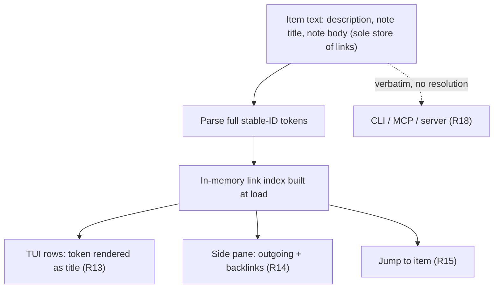
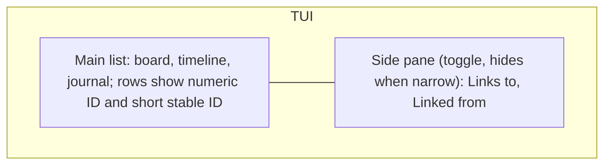

# Backlinks - Plan

## Goal Capsule

- **Objective:** In the TUI, a user can link any task or note to another with an inline `[[…]]` reference, see from any item what it links to and what links to it, and jump between them, with links that survive edits, moves, archive, restore, and sync; a link to an archived item shows as broken until that item is restored.
- **Product authority:** This Product Contract. CLI, MCP, and server behavior are explicitly out of active scope (R18).
- **Open blockers:** None. Node.js taskbook compatibility is an unverified assumption, not a blocker (see Dependencies / Assumptions).

---

## Product Contract

### Summary

Items gain a permanent, letters-only stable ID alongside the existing numeric ID, modeled on jj's change ID vs commit ID split. Links are `[[stable-id]]` tokens in item text, which is the only place they are stored. The TUI resolves them into titles, shows outgoing links and backlinks in a side pane, and lets the user jump between linked items.

### Problem Frame

Taskbook has no durable way to say "this note is the context for that task" or "this task depends on that one." The only handle on an item is its numeric ID, and that ID is positional: it is `max + 1` at creation, it is reassigned when an item is archived, reassigned again when it is restored, and reused when the highest-numbered item is deleted. A reference written as "see #12" today can silently point at a different item tomorrow.

This is the same problem jj solves by separating the change ID (random, permanent, what users see and type) from the commit ID (content-derived, rewritten constantly, secondary). Taskbook's numeric ID plays the commit-ID role and has no change-ID counterpart.

Because sync stores items as opaque client-encrypted blobs and replaces the whole set on each `PUT /items`, any linking scheme has to work entirely on the client and tolerate last-write-wins across devices.

### Key Decisions

- **Inline links, text as the single source of truth, plus a non-text way to add one.** Links live in the item text; a TUI keybind appends a token rather than maintaining a separate relation list. Governs R7, R11. (session-settled: user-directed — chosen over explicit-only structured relations and over inline-only: inline matches the Workflowy model, the keybind covers linking without editing text.)
- **Tokens carry only the stable ID.** Raw text shows `[[kqzxmvtn…]]`; views render the title. Governs R7, R13. (session-settled: user-directed — chosen over `[[Title|id]]` and `[[Title]]`: no stale titles in text, no rename or duplicate-title breakage.)
- **A new stable ID beside the numeric ID, shown jj-style in the TUI.** Numeric IDs keep working unchanged; the stable ID is displayed as a shortest unique prefix. Governs R1, R4, R6. (session-settled: user-directed — chosen over making numeric IDs permanent, over a hidden-only stable ID, and over replacing numeric IDs everywhere: it follows jj's model without breaking CLI muscle memory or pulling the CLI into scope.)
- **Letters-only alphabet, full ID stored, shortest prefix displayed.** Lexical disjointness makes `[[12]]` and `[[kqz]]` unambiguous without lookup; prefixes never go into stored text because a unique prefix can become ambiguous as items are added. Governs R2, R6, R7, R8. (session-settled: user-approved — proposed from jj's reverse-hex change IDs with the prefix-ambiguity tradeoff shown.)
- **Deterministic backfill.** Pre-existing items get IDs derived from immutable data so two synced clients upgrading independently agree. Governs R3. (session-settled: user-approved — chosen over random backfill: random IDs plus last-write-wins `PUT /items` would silently break links made on the losing client.)
- **TUI only for v1.** Governs R18. (session-settled: user-directed — chosen over also covering CLI and MCP.)
- **Outside the TUI, tokens stay raw.** Governs R18. (session-settled: user-directed — chosen over read-only title rendering in CLI/MCP: zero work outside the TUI and lossless MCP round-tripping.)
- **Archived targets are broken links.** Governs R16. (session-settled: user-directed — chosen over resolving archived targets with an "archived" marker and over full archive parity; the jj hidden-commit analogy was raised afterward and the choice was kept.)
- **Side pane for links and backlinks.** Governs R14, R15, R17. (session-settled: user-directed — chosen over a filter-view swap and a popup: links stay visible while browsing.)

### Requirements

**Stable identity**

- R1. Every task and note has a stable ID that is assigned once and never changes across edit, move, star, state change, archive, restore, or sync.
- R2. Stable IDs use a letters-only alphabet, so no stable ID or prefix of one can be read as a numeric ID.
- R3. Every stable ID, for new and pre-existing items alike, is a deterministic function of creation fields that never change and that older versions preserve, so any client that finds an item without one (on first upgrade, or after an older version dropped it) assigns the identical ID.
- R4. Numeric IDs keep their current allocation and behavior for every existing CLI, TUI, and MCP operation.
- R5. Older taskbook-rs versions can still read item data written by this version.
- R6. The TUI shows each item's stable ID as its shortest unique prefix, visually distinguished, next to the numeric ID.

**Writing links**

- R7. A link is a `[[<full stable ID>]]` token in a task description, note title, or note body; only well-formed full stable-ID tokens are links, and any other `[[…]]` in stored text is plain text.
- R8. When text is saved from TUI input or from the TUI-launched `$EDITOR`, each `[[N]]` (numeric) and `[[<prefix>]]` (stable-ID prefix) is rewritten to the full stable-ID token of the matching active item.
- R9. A save that contains a numeric or prefix reference matching no active item, or more than one, is rejected with a message naming the reference, and nothing is written.
- R10. Full stable-ID tokens already in the text are preserved verbatim on save, whatever the state of their target.
- R11. A TUI keybind on the selected item lets the user pick a target item and appends a link token to the selected item's description without manual text editing.
- R12. Typing `[[` in TUI text input opens item autocomplete, and accepting a suggestion inserts the full stable-ID token.

**Viewing and following links**

- R13. TUI item rows render each link token as the target's current title, visually marked as a link, instead of the raw ID.
- R14. A side pane shows the selected item's outgoing links and its backlinks (active items whose text links to it), each as title plus short stable ID, and updates as the selection moves.
- R15. From the side pane the user can jump to any listed item, and the TUI switches board or view as needed so that item is selected and visible.
- R16. A link whose target is archived or absent renders as a broken-link marker, archived items contribute no backlinks, and restoring an item makes its inbound and outbound links resolve again with no other action.
- R17. The side pane can be toggled with a key and is hidden automatically when the terminal is narrower than a minimum width.

**Outside the TUI**

- R18. CLI output and input, MCP tools, and the server are unchanged, and link tokens appear there verbatim.

### Key Flows

- F1. Link while writing
  - **Trigger:** User creates or edits a task in the TUI.
  - **Steps:** Types `[[`; autocomplete lists items; user picks a note; the full token is inserted; user saves.
  - **Outcome:** The task row shows the note's title as a link; selecting the note shows the task under its backlinks.
  - **Covered by:** R7, R12, R13, R14
- F2. Link without editing text
  - **Trigger:** User presses the link keybind on a selected item.
  - **Steps:** Picks a target; token is appended to the selected item's description.
  - **Outcome:** Same as F1.
  - **Covered by:** R11, R14
- F3. Follow a backlink
  - **Trigger:** User selects an item with backlinks.
  - **Steps:** Side pane lists referrers; user moves to an entry and confirms.
  - **Outcome:** The referrer is selected and visible, on its own board or view.
  - **Covered by:** R14, R15
- F4. Archive and restore a linked item
  - **Trigger:** User deletes an item other items link to, then later restores it.
  - **Steps:** Delete moves it to the archive; referrers show broken markers. Restore brings it back with a new numeric ID and the same stable ID.
  - **Outcome:** Links resolve again and the backlinks reappear.
  - **Covered by:** R1, R16

### Acceptance Examples

- AE1. **Covers R8, R9.**
  - **Given** active item 12 exists, no item 99 exists, and two active items have stable IDs starting `kq`.
  - **When** the user saves `see [[12]]`, `see [[99]]`, and `see [[kq]]` in turn.
  - **Then** the first is stored as the full token for item 12; the second and third are rejected with a message naming `[[99]]` and `[[kq]]`, and nothing is written.
- AE2. **Covers R10, R16.**
  - **Given** a note body containing a full-ID link to an archived task.
  - **When** the user edits an unrelated line of the note in `$EDITOR` and saves.
  - **Then** the save succeeds, the token is unchanged, and the link still renders as broken.
- AE3. **Covers R7, R18.**
  - **Given** a task created via the CLI as `tb --task "see [[12]]"`.
  - **When** it is viewed in the TUI.
  - **Then** `[[12]]` is plain text, not a link, and no backlink appears on item 12.
- AE4. **Covers R3.**
  - **Given** two synced clients holding the same pre-upgrade items.
  - **When** both upgrade and load before either syncs.
  - **Then** each item has the same stable ID on both clients, and links made on either client resolve on both after sync.
- AE5. **Covers R1, R16.**
  - **Given** task 7 is linked from three items.
  - **When** task 7 is deleted, then restored and assigned numeric ID 15.
  - **Then** while archived, all three referrers show a broken marker and task 7 appears in no backlink list; after restore, all three links resolve to task 15 and its side pane lists the three referrers.
- AE6. **Covers R17.**
  - **Given** a terminal narrower than the minimum width.
  - **When** the TUI starts or is resized below it.
  - **Then** the side pane is hidden and the main list uses the full width; widening the terminal restores the pane if it was toggled on.

### Scope Boundaries

**Deferred for later**

- CLI rendering of link tokens, `tb --link`, `tb --backlinks`, and accepting stable IDs as CLI targets (the CLI `@` sigil already means boards).
- MCP link fields on `list_items`, a link tool, and protecting tokens from being dropped by `edit_item`.
- A warning when deleting an item that has backlinks.
- Resolving archived targets with an "archived" marker instead of a broken one.

**Outside this work's identity**

- Workflowy-style mirrors or transclusion (one item shown live in two places).
- Links to boards or tags, and hierarchical parent/child items.
- Any server-side link index; the server never sees plaintext.

### Dependencies / Assumptions

- Older taskbook-rs versions, including a long-running `tb --mcp` process started before the upgrade, drop the unknown stable-ID field on any write because the item structs keep no unknown fields. R3 re-derives the same IDs on the next load by the new version, so links survive a mixed-version window.
- The original Node.js taskbook has not been checked for whether it keeps unknown item fields when it rewrites `storage.json`. If it drops them, R3 re-derives the IDs as long as Node preserves the creation fields they are derived from.
- MCP `edit_item` replaces the whole description (`crates/taskbook-client/src/mcp/tools.rs:387`), so an agent that rewrites a title without copying a token removes that link, and nothing catches it.
- The first load after upgrade writes the full dataset once to persist backfilled IDs; with sync enabled that is a one-time full upload.
- Sync stays last-write-wins on the whole item set (`crates/taskbook-server/src/handlers/items.rs:144`); this plan does not change it.

### Outstanding Questions

**Resolve Before Planning**

- None.

**Deferred to Planning**

- Stable-ID length and exact alphabet, and how a derived ID that collides with an existing one is handled.
- Which immutable creation fields drive the derivation (`_timestamp` and `_isTask` are the only ones that never change today), and how two items with the same creation timestamp get distinct IDs.
- Whether R11's appended token goes into a note's title or body.
- Side-pane focus model and keybinds (switching focus between list and pane, the link keybind, the toggle key), and the minimum-width threshold.
- How the `[[` autocomplete trigger fits the existing autocomplete, which today runs only for `/`-prefixed command input.
- Whether a self-link or a repeated link to the same target is shown once or per occurrence.
- Verifying the Node.js unknown-field behavior, and documenting the result.

### Sources / Research

- ID allocation and renumbering: `crates/taskbook-client/src/taskbook.rs:71` (`generate_id`, `max + 1`), `:323` (`save_item_to_archive`), `:337` (`save_item_to_storage`).
- Item models and serde compatibility: `crates/taskbook-common/src/models/task.rs`, `crates/taskbook-common/src/models/note.rs`.
- Existing sigils: `+tag` and `@board` parsing in `crates/taskbook-common/src/board.rs:90`; `@<id>` targets in `crates/taskbook-client/src/taskbook.rs:730`; `[[` is unused in the client.
- Sync storage: opaque per-item blobs keyed by `item_key` in `crates/taskbook-server/src/migrations/001_initial.sql`; full-set replace in `crates/taskbook-server/src/handlers/items.rs`.
- TUI layout: a single vertical split in `crates/taskbook-client/src/tui/ui.rs:20`; `PopupState` has only `Help` (`crates/taskbook-client/src/tui/app.rs:106`); no width-based layout today.
- TUI autocomplete: `@` suggests boards, item suggestions come from bare tokens after `/` commands (`crates/taskbook-client/src/tui/autocomplete.rs:42`, `:67`, `:160`).
- Note bodies: edited in `$EDITOR` (`crates/taskbook-client/src/editor.rs`); the TUI shows only a `[...]` marker or the journal's first line (`crates/taskbook-client/src/tui/widgets/item_row.rs:80`, `crates/taskbook-client/src/tui/widgets/journal_view.rs:150`).
- jj change ID vs commit ID, reverse-hex alphabet, shortest-prefix display: https://jj-vcs.github.io/jj/latest/glossary/#change-id
